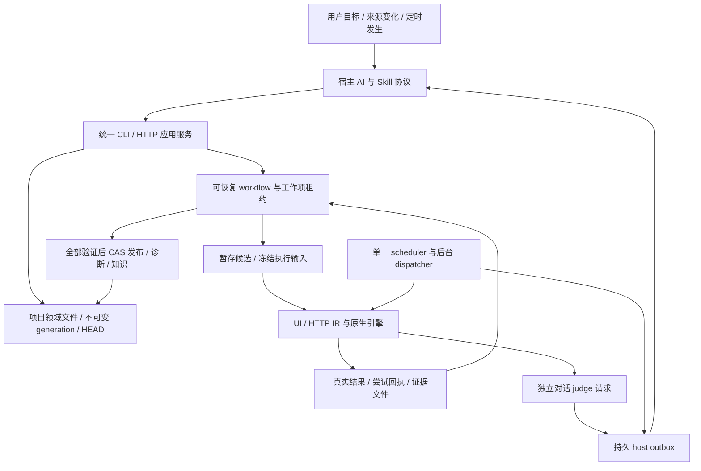

# autoSkill 架构审查与演进方案

日期：2026-11-13。本次更新依据当前源码、已完成的专项验证和多 agent 独立验收，将原实现前审查改为已实现架构说明。全项目回归：**待整体回归**。专项结果与平台边界见[系统化技能与多轮对话验证](../reports/系统化技能与多轮对话验证.md)；不要将专项通过替换为整包通过。

## 1. 当前系统与责任边界

autoSkill 已从录制回放工具扩展为由 skill 驱动的本地测试系统。宿主 AI 理解需求、提出方案和评审语义；应用服务持久化任务、验证引用与版本、驱动真实执行、保存证据。原有底层命令继续可用，默认流程不加入人工确认、站点围栏或风险审批。

| 层 | 已实现职责 | 不应混淆的结论 |
| --- | --- | --- |
| Skill 与宿主 | 按工作项读取阶段协议，领取、续租、提交、继续；模型配置归宿主 | Python 后端不能在没有宿主时自行理解需求 |
| Workflow | 来源到知识的阶段闭环、覆盖检查、候选验证、恢复与修订 | 工作完成不等于业务通过 |
| 领域资产 | 来源、需求、场景、oracle、原生资产和定义的不可变版本 | SHA 说明内容身份，不证明业务预期正确 |
| 执行服务 | 消费冻结输入，真实 UI/API/原生执行，保存独立尝试 | 进程退出为零、HTTP 200 或动作成功不自动成为业务 Pass |
| 独立 judge | 评审回答是否符合原目标、反问是否必要以及如何继续 | 被测 AI 自述“正确”不构成独立评审 |
| 调度与宿主投递 | 到期发生记录、入队、投递与恢复 | 消息送达不等于任务成功，宿主激活不等于唤醒电脑 |

CLI、HTTP API 与插件调用共享服务，不各自复制阶段业务逻辑。主要实现位于 `skills/autoskill/app/autoskill/`；DSH 接入位于 `plugin/`。

## 2. 事实来源、版本和分享

| 数据 | 权威位置 | 派生或本机状态 |
| --- | --- | --- |
| 可执行 UI/API 用例 | 项目 `testcases/*.json` | SQLite 索引、仪表盘、设计表 |
| 来源原文及文本、需求、场景、oracle、workflow 定义、知识版本、原生文件树 | 项目 `domain/` 的不可变 generation 和对象 | 按需读取、摘要及覆盖视图 |
| 工作项、attempt、operation、租约、请求幂等回执、运行与 judge | 本机 SQLite 与 `.local` 证据 | 仪表盘、报告、分页查询 |
| 定时定义与 occurrence | 单一调度服务的本机持久状态 | workflow 保存关联，不复制第二个时钟 |
| Excel | 兼容模式的设计输入或结果视图 | 手动标记不能生成真实运行证据 |

`domain.py` 以内容寻址对象保存 JSON 和二进制文件，以完整 manifest 描述一代内容，最终原子替换 `HEAD.json`。暂存提案不会提前修改正式定义。提交比较 expected HEAD；允许合并互不相干的路径时，仍逐项检查被修改或删除路径的基础引用是否变化。

文件系统与 SQLite 没有被伪装成一个跨存储事务。先持久化发布意图，再发布领域 generation，最后记录本机回执；中断后根据操作身份与已有 generation 恢复。域定义可分享，本机的租约、待执行任务和运行历史不随项目包被认作另一台机器的已验证事实。

普通项目包和完整包按清单校验项目附件、领域对象及原生文件。完整包包含本地凭据和登录态是既有产品行为；普通包保留可选凭据加密。公开验收文档另行选取脱敏摘要，不发布原始 `auth.json`、Cookie、HAR、请求头或可能含凭据的执行快照。

## 3. 已实现的 workflow 闭环

阶段为 `sources → requirements → design → coverage/completion → materialize → execute → diagnose/maintain → knowledge`。

1. **来源**：快照原始文件与已提取文本，保留 URI、内容 hash 和关系。需要语义提取的来源交给宿主任务处理，服务不把二进制文档假装成已理解的文字。
2. **需求与设计**：AI 提交带来源引用的需求、场景与独立业务预期。后端检查引用、结构及每项需求的覆盖；缺项进入 completion。覆盖检查证明关联存在，语义是否充分仍需要评审。
3. **物化**：生成完整候选用例及场景绑定，保存基础用例 hash。与需求 oracle 不一致的声明不能靠提交一个“通过”字段获得接受。
4. **执行**：候选通过 `runner.prepare(candidate_cases=...)` 冻结，随后在同一数据库事务登记执行意图与 run。执行器使用候选快照，正式用例保持原样。
5. **发布与维护**：全部约定重复轮次结束，核对真实回执、内容和输入范围后才做一次 CAS。维护候选只有满足既定验证，包括已声明性能目标，才替换正式用例。首次设计发现真实业务缺陷时，可以保存这个经过验证的失败用例，同时明确报告 violated。
6. **诊断与知识**：保存真实失败、调查结论和引用，不用实际错误响应覆盖业务 oracle。知识回写不应使刚完成的同一验证无故失效；当前证据比较排除纯派生知识与诊断字段。

`revise` 接受新来源并开启新周期，重新设计、验证受影响内容。因此需求确实变化时可以自动更新 oracle，不需要人工审批；旧来源版本、旧期望和旧失败继续保留。任务可以 `complete=true` 且 `conclusion=violated`，也可以因证据不足得到 incomplete。

工作流、item、attempt、operation、session、run、schedule occurrence 使用不同身份。幂等键同时绑定请求内容，相同键重试返回同一回执，改内容则冲突；旧租约不能覆盖新 attempt。长任务通过 heartbeat/release 续租与让出。

录制使用显式 workflow binding，不以“当前会话最近领取的任务”猜测归属。动作前先记录 operation intent，动作后记录实际 receipt。发生崩溃而外部效果未知时进入恢复调查，通过只读查询和原后置条件判断现状；租约到期不是动作尚未执行的证明。这提供可恢复过程，不宣称外部业务 exactly-once。

## 4. 冻结输入与执行器

`runner.prepare` 在入队前冻结用例及依赖链、配置、认证输入、相关来源与 oracle、引擎身份；执行时实际消费这些输入。队列中的运行不因为正式用例被编辑而悄悄换版本。相同 ID、相同整数 revision、不同正文不能继承旧 Pass。

每个结果关联用例内容 hash、输入范围 hash、attempt 回执及证据文件。`result_evidence` 验证该次冻结输入与本机证据；`result_current` 进一步比较当前相关输入。运行结束后重新读取现有文件补算 SHA，或由 AI 单独提交一个 SHA，都不是实际执行证明。快照也不意味着被测远端数据库、服务和整个操作系统都被完全冻结。

| 引擎 | 当前实现 | 等价性与环境边界 |
| --- | --- | --- |
| Playwright / Selenium UI IR | 共用动作循环和断言判定，驱动提供浏览器原语 | 定位、浏览器版本和真实站点仍需分别验证 |
| HTTP API IR | 按冻结依赖提取变量，业务与性能断言分开 | 不能用 API 通过代替 UI 展示、权限交互或浏览器行为 |
| 独立 Playwright/Selenium 脚本、Postman 导出 | 保留声明断言与变量，导出说明语义差异 | 首错停止、定位候选、验证码人工输入、登录与历史管理并非完整运行器的天然等价物 |
| `selenium-pytest` / `selenium-unittest` | 原生执行原目录、POM、参数化和 fixture | 不自动重写成线性 UI IR；依赖和运行时按实际安装探测 |
| `postman-newman` / `apifox` | 执行本地集合与原生脚本，读取原生结果 | 云端项目、私有扩展及脚本兼容性以实际 CLI 为准 |
| `ai-eval` | HTTP、SSE、WebSocket 多轮会话与并发评估、WebSocket 音频 | WebRTC 不是该传输适配器的已验收替代能力 |

原生资产的完整文件树、入口参数数组、工作目录和版本存入领域文件；排队后不再读取可变的原导入目录。原生进程有取消、超时、子进程清理和证据归档。原生报告中的断言失败不能被成功退出码掩盖；缺少运行工具或可解析证据时返回明确诊断，不自动宣布业务 Pass。

当前 workflow 的 materialize/execute 候选是 UI/API IR。原生资产使用 `native import/run` 及同一调度体系，宿主 skill 可以组合这些服务；这不表示任意原生资产已自动接入 workflow 的全部覆盖与候选发布阶段。

## 5. 每步后置条件与失败证据

高层业务动作应声明可核查的直接后置条件。动作执行成功和后置条件满足是两件事。当前实现保留失败现场 check 的声明期望、实际值与结果；第一次失败也不会因为“只录入通过的断言”而从用例中消失。由 HAR 响应样本自动推导的规则标为 observation，不能替代来源独立的业务预期。

已观察的业务 Fail 在后续缺凭据、验证码重试、环境中断或成功尝试之后仍然保留。每次尝试和截图有独立引用。复用登录态只证明 session probe 对当前状态成立，不能宣称整条登录流程已经重新执行。

| 维度 | 判定例子 |
| --- | --- |
| 执行 | 请求/浏览器动作是否完成，是否被取消或环境阻塞 |
| 业务 | 独立声明的预期是否满足；无断言或仅 observation 为 Unverified |
| 性能 | 已声明的 `max_ms` 或其他阈值是否满足；未声明目标不凭时延推定通过 |
| 回答质量 | 独立数据计算、检查与宿主评审结果；在 AI 场景汇入业务结论，保留逐项依据 |

业务 Pass、性能 Fail 是有效组合，整体结论仍为失败；不能为方便展示把性能失败改写成业务错误，也不能让 workflow 宣称 satisfied。

参考用户提供的 Shopify 文章《How we raised mobile end-to-end test stability to 98%》（Michael Garfinkle，2026-08-12，[原链接](https://shopify.engineering/mobile-e2e-testing)），本次采用了声明后置条件、等待、逐次证据和保留重试历史的原则。分析原文来自用户提供的全文，原链接在审查环境中无法直接访问。

“动作前 false、动作后 true”适用于明确状态转移，例如新增后出现、删除后消失、提交后状态变化；查询已有数据、幂等保存和持续成立条件应使用各自的关系。当前 IR 支持等待、来源状态、连续成立窗口及持续不变量；轮询只能观察采样时点，不能保证捕捉任意瞬时闪断。

语义 DOM 定位继续有效。截图和现有图像原语可以补充 Canvas、图标或可见性证据；自动理解每个页面、完整视觉 oracle、PaddleOCR/OpenCV 全量接入、移动端 Appium 和逐步视频不是本轮已完成能力，也不要求先替换全部执行引擎。

## 6. 独立 AI judge 与一条 case 的多轮对话

一个 case 是一个完整对话目标。轮次共享消息历史、Cookie、服务端会话标识及明确提取的变量；并发 case 分别隔离。结果保存每轮请求、观察、检查、judge 与耗时，并汇总为一条 case。中间失败不会被最后一轮正确答案刷掉。

`dialogue_judge.py` 冻结 prompt、history、answer、rubric、reference 和 case 上下文，持久化 judge 请求；宿主通过 claim/submit 租约提交独立判断。被测服务返回的自评分不是 judge 回执。输出包含 verdict、后续 action、简要理由、反问的必要性/相关性/是否已回答，以及证据引用；不要求采集模型隐藏思考过程。

- 必要反问且已有补充事实：宿主自然表达回复，`facts_used` 指向冻结的 context/userfacts/reference，服务记录原值 hash。
- 重复询问已给信息或明显离题：保留 Fail，可以继续获得后续诊断；后续正确不抹除前轮 Fail。
- 确实缺少用户选择或业务事实：保留 needs_clarification/Unverified，不从可选数据项编造用户意图。
- `continue` 没有预设后续轮时，内核使用固定的“继续按原目标及已有信息作答”提示，不把 judge 的理由当作新增业务事实。

核心检查引用存在、hash 一致、租约有效和结构不矛盾；它不声称能靠字符串匹配证明自然语言回复正确。语义合理性由独立评审承担，评审理由与输入出处可复核。

默认响应断言立即判定。只有明确标记 `expected_phase="final_answer"` 的 expected/reference，或 `when="final_answer"` 的检查，才可在合理澄清轮暂缓；judge 不能用“需要澄清”覆盖已经成立的业务失败。

AI 问数优先从冻结数据和明确聚合规则独立计算预期，再核对筛选、年份、单位、分母和回答。正确性与性能分开测量。流式协议区分首字节、首个有效内容、最后内容及正常协议终止；心跳不是答案，断流不是正常完成，也不把客户端观测延迟称为模型内部思考时间。SSE/WebSocket 的 `content_pointer` 是增量，`final_answer_pointer` 是完整答案快照；重复最终快照不重复追加正文，`protocol_complete_ms` 单独记录终止时间。

## 7. 后台调度、宿主投递和多会话

`server/scheduler.py` 是唯一调度时钟，支持回放、原生执行和维护任务。创建/更新请求幂等，定义更新比较 revision；每次 occurrence 有独立身份。到期发生记录、run 入队或 host outbox、下次时间更新在同一 SQLite 事务中提交。规则保留时区，重叠采用显式 skip/queue 策略。

`server/jobs.py` 的独立 dispatcher 在 CLI 退出后继续处理队列和已启用的定时任务，不依赖仪表盘窗口一直打开。进程锁与 `.local/queue-worker.json` 防止重复后台执行者；没有 queued/running 运行和 enabled 计划后才空闲退出。启动失败保留已入队 run ID，可恢复原请求。全局并发预算继续生效；共享项目登录态的回放串行，使用隔离输入的同项目原生任务可并行。

定时维护和新 judge 请求写入 `host_outbox`。DSH adapter 用真实 SDK 形状的会话解析、prompt 与 flush 合同，先保存本地投递日志，再调用宿主并确认持久化。投递结果未知时核对宿主收据，不盲目重发；不另建第二个 DSH 周期计划。运行环境明确带 host、host_session、session 和 workflow binding，未指定宿主时为 generic，不自动假设存在 DSH。

原生运行默认异步，使唯一活跃宿主能继续领取自己的 judge 工作；不能一边同步等待完成，一边阻塞唯一评审者。宿主不在线或判定等待超时会保留请求与证据，不能静默变成通过。DSH 插件需要宿主正在运行；开机自启和操作系统服务由部署环境负责。

## 8. 大规模资产读取与既有脚本纳管

CLI 和 HTTP 提供共享摘要、分页与完整定义读取。workflow 状态 cursor 绑定 revision，域读取固定 head；原生运行摘要按需分页，单条 conversation 可读取全部轮次与证据引用。长文本显式分段，不能因页面大小为 1 就塞入整份超大文档，也不能以省略字段的展示对象覆盖完整定义。

跨 bridge 的来源路径按调用方解析，传递明确声明的附件及内容 hash；临时落盘路径不进入请求语义身份。同一原文重复传输保持幂等，同一路径内容变化不能复用旧请求回执。

既有 Selenium 分层工程和 Postman/Apifox 集合先按原生资产纳管，保留入口、数据、fixture 与报告。文件发现不等于语义迁移完成；当前没有把任意既有框架自动转换成等价 UI IR 的承诺。需要转换时，应以真实正反例、数据与清理行为比较原版本和转换版本。

## 9. 稳定性与验收口径

Shopify 的 98% 表示测试成功次数除以运行次数，不是 AI 生成或判断准确率。本轮没有发布 autoSkill 达到 98% 的结论。合成站点是可重复反例与传输验证环境，不能据此估算真实模型准确率或生产容量。

| 指标 | 建议固定口径 |
| --- | --- |
| 首轮成功率 | 首次 attempt 全部声明验证通过的运行数 / 计划运行总数；另列未启动、取消和 Blocked |
| 重试后成功率 | 完成允许重试后通过的运行数 / 同一计划分母；同时保留曾失败标记 |
| 重试成本与波动 | attempt 分布、失败后成功数、同输入跨轮 Pass/Fail 变化、恢复耗时 |
| 业务与性能 | 业务 Fail、Unverified、环境错误、SLA Fail 分列，不相互抵消 |
| AI 质量 | 独立预期或评审通过的完整 case 数 / 计划 case 数，声明样本来源、任务分布和评审方法 |
| 负载 | 实际并发、请求/轮次数、吞吐、时延分位数与错误；宿主 judge 等待单列 |

上述稳定性口径是分析要求，不意味着仪表盘已展示全部统计。现有卡片的 `Pass/(Pass+Fail)` 不含 Blocked，应保留其标签，不能直接当作全体计划成功率。多轮测试按完整 case 计质量成功，不能用成功轮数稀释中间失败。

## 10. 已验收范围与下一步

已实现并有专项证据的内容包括领域 CAS、冻结输入、候选测试后发布、真实业务失败保留、多会话恢复与幂等、原生工具执行、后台调度、独立 judge、多轮对话及浏览器捕获到对话资产的闭环。详见验证报告中的测试与外部摘要引用。

仍需按真实环境继续验收：

- DSH 完整宿主中的实际自动激活、会话恢复和模型驱动维护。当前为 SDK 形状替身及真实本机 HTTP/CLI 回执闭环，未做 DSH 真机验收。
- Windows/UOS 上的本轮全链路，当前未实机验收；Linux 通过不外推为所有平台通过。
- WebRTC 音频实际接收。本环境受管策略导致零 ICE candidate、零接收包，验收为 Blocked；权限失败与资源回收测试通过不能替代音频通过。
- 对真实业务需求、真实模型和生产等价负载的样本评估。当前固定数据反例和本地并发证明实现行为，不证明泛化准确率或目标容量。
- 更丰富的视觉检查、协议适配与统计视图按实际需要增加，不以重写全部引擎或扩大依赖为前提。

这些是能力验证边界，不是新增用户使用审批或人为功能限制。整体回归、版本包与升级的最终结果由最终发布记录填写。

## 11. 实现与证据索引

| 主题 | 源码 / 专项依据 |
| --- | --- |
| 领域版本与用例 CAS | [domain.py](../skills/autoskill/app/autoskill/domain.py)、[projects.py](../skills/autoskill/app/autoskill/projects.py)、[test_domain.py](../tests/test_domain.py) |
| Workflow 与恢复 | [workflow.py](../skills/autoskill/app/autoskill/workflow.py)、[workflow_execution.py](../skills/autoskill/app/autoskill/workflow_execution.py)、[workflow_recovery.py](../skills/autoskill/app/autoskill/workflow_recovery.py)、[test_workflow.py](../tests/test_workflow.py) |
| 不可变执行与证据 | [execution_inputs.py](../skills/autoskill/app/autoskill/execution_inputs.py)、[runner.py](../skills/autoskill/app/autoskill/runner.py)、[test_execution_inputs.py](../tests/test_execution_inputs.py) |
| 原生资产与执行 | [native_assets.py](../skills/autoskill/app/autoskill/native_assets.py)、[native_run.py](../skills/autoskill/app/autoskill/native_run.py)、[engines](../skills/autoskill/app/autoskill/engines/)、[test_native_engines.py](../tests/test_native_engines.py) |
| AI 评审与多轮 | [dialogue_judge.py](../skills/autoskill/app/autoskill/dialogue_judge.py)、[ai_eval.py](../skills/autoskill/app/autoskill/engines/ai_eval.py)、[test_dialogue_judge.py](../tests/test_dialogue_judge.py)、[test_ai_evaluation.py](../tests/test_ai_evaluation.py) |
| 调度与宿主 | [scheduler.py](../skills/autoskill/app/autoskill/server/scheduler.py)、[jobs.py](../skills/autoskill/app/autoskill/server/jobs.py)、[host-adapter.mjs](../plugin/host-adapter.mjs)、[test_host_outbox_loop.py](../tests/test_host_outbox_loop.py) |
| 捕获、断言及导出 | [recorder/session.py](../skills/autoskill/app/autoskill/recorder/session.py)、[replay/ir.py](../skills/autoskill/app/autoskill/replay/ir.py)、[录制转对话与压测验证](../reports/录制转对话与压测验证.md) |
| 最终验收口径 | [系统化技能与多轮对话验证](../reports/系统化技能与多轮对话验证.md)、[Ticket Desk 真人提示词](../skills/autoskill/examples/ticket-desk/ACCEPTANCE.md) |
