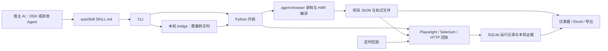
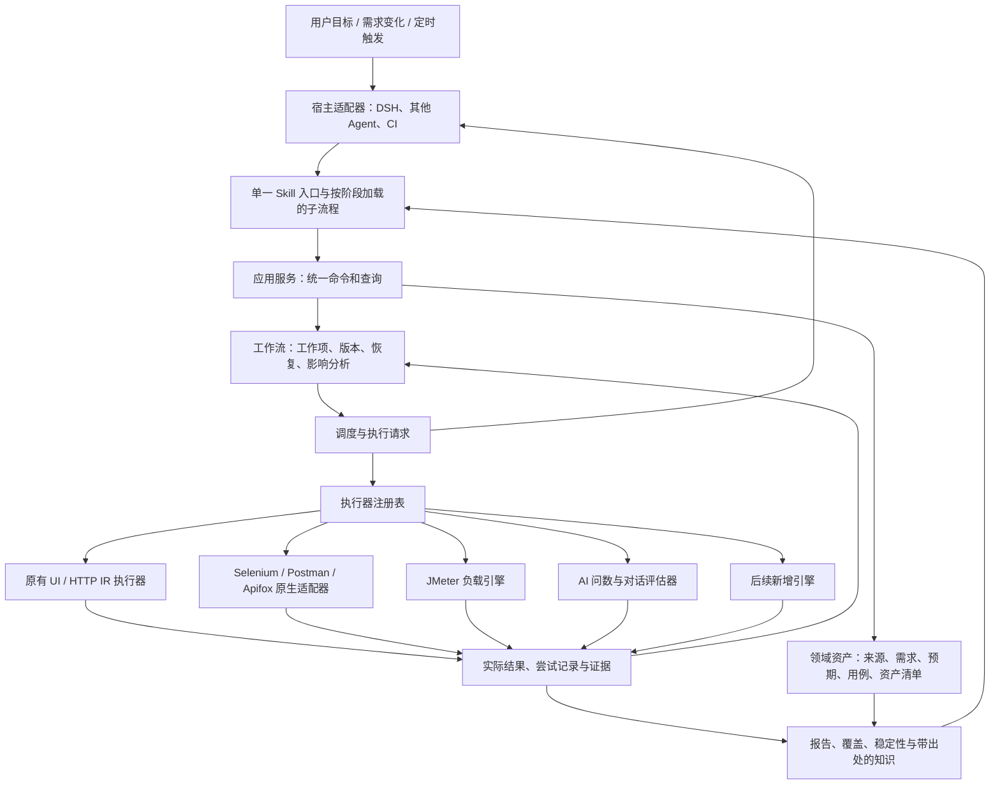

# autoSkill 架构审查与演进方案

日期：2026-11-13。基于 `96f6d07` 及本轮六个 agent 的只读架构审查。本文区分当前实现与目标设计；目标接口、压测引擎、迁移适配器和全自动维护尚未实现，不能作为已经通过的功能清单。

## 1. 总体结论

autoSkill 可以发展成以 skills 为操作协议的测试系统。现有录制、Playwright/Selenium/HTTP 回放、项目资产和仪表盘可以继续复用。扩展前需要先建立领域资产、应用服务、执行适配器、版本证据和宿主唤醒的清晰边界。

本轮不直接实施先前提出的四张 workflow 表。表的数量应由事实来源和事务边界决定；把阶段字段加进数据库，并不能解决自动维护、跨会话恢复或资产迁移。

目标包含：

- AI 自动拆分需求、生成、检查和补全用例，实际执行后生成报告与知识。
- AI 根据需求或页面变化更新用例，保留版本、原业务预期和验证证据。
- AI 创建、更新和管理定时回归、定时维护、性能测试与 AI 评估任务。
- 多个 AI 会话同时处理任务，中断后可以恢复。
- 纳管和迁移分层 Selenium、Postman/Apifox、JMeter 与现有接口巡检。
- 通过引擎适配器增加压测、AI 问数、流式对话等能力。
- 几千条用例按需读取，不将全部资产写入模型上下文。

默认流程全自动，不加入人工确认阶段、站点围栏或 `UNSAFE_` 审批。业务信息不足或环境不可用时保存具体阻塞，继续处理独立工作；不凭空补造规则，也不把阻塞说成通过。

## 2. 当前系统实际上怎样工作

当前可用的基础：

| 部分 | 当前事实 | 依据 |
| --- | --- | --- |
| 通用 skill 与 DSH | 插件登记 skill、启动仪表盘；核心不依赖 DSH 模型 SDK | `plugin/index.mjs` |
| 多会话 | 录制、浏览器、临时文件和默认用例表按会话隔离；项目数据共享 | `task_context.py`、`recorder/session.py`、`locking.py` |
| 录制与回放 | 真实动作生成线性 UI IR，HAR 生成 API 用例；回放不调用 AI | `recorder/compile.py`、`replay/ir.py`、`runner.py` |
| 用例设计 | `plan write` 生成自然语言设计表，不自动生成可执行测试 | `plan.py` |
| 调度 | 已有任务 API 和定时回放；没有接通定时 AI 维护 | `server/scheduler.py`、`server/app.py` |
| 分享 | 普通项目包；完整包包含可移植凭据与登录态 | `share.py` |
| 外部资产 | 能导出脚本和 Postman；当前 `import` 主要导入 autoSkill 包 | `cli.py`、`replay/codegen.py`、`replay/postman.py` |

以上 Python 模块位于 `skills/autoskill/app/autoskill/`。本轮多会话通过了真实本机 CLI、HTTP 转交、双浏览器录制与回放测试；这不代表 DSH 智能体实机验收已经通过。

## 3. 扩展前必须处理的架构问题

### 3.1 全自动需要明确由谁持续驱动

skills 是可由 Agent 执行的操作协议。当前插件只启动仪表盘，没有启动或恢复 AI 的能力；Python worker 只执行确定性回放。即使增加 `next/submit/lease`，宿主 AI 退出后也不会自动继续理解需求。

应明确两种驱动：

- 活跃会话：宿主 AI 根据持久状态领取工作，执行当前阶段并提交产物。
- 无人值守：调度器通过宿主适配器唤起 AI，传入 workflow 和工作项引用；内核负责等待、验证和恢复。

本机安装的 DSH `0.2.2-rc.1` 存在 `dsh-schedule` 服务和 `schedule_create/list/view/edit` 接口，可作为适配依据；当前 autoSkill 插件尚未接入，本轮没有验证真实定时唤醒。投递成功只表示指令进入宿主，不表示用例维护成功。

DSH 宿主需保持运行；这里的唤醒是激活 Agent 会话，不包含启动已经退出的 DSH 或唤醒电脑。需要宿主进程自动启动的部署，由操作系统或 CI 的运行服务负责。

模型、提供商和密钥配置归宿主。autoSkill 保存宿主绑定、任务和产物引用，不再维护一套独立模型配置。

### 3.2 文件、数据库和 Excel 不能各自保存一份可独立编辑的真相

当前项目 JSON 是用例事实来源，SQLite 的项目/用例表主要是索引；运行结果和调度则保存在 SQLite。Excel 是独立设计输入，也可手动标记通过。

如果新增需求、场景和关联只存 SQLite，分享项目时会丢失；如果数据库、Excel、JSON 都允许独立修改同一个定义，自动维护会发生覆盖与漂移。

应采用以下所有权：

| 数据 | 权威位置 | 其他形式 |
| --- | --- | --- |
| 来源原文、提取文本、需求、业务预期、场景、用例、资产及关联 | 项目目录中的版本化领域文件 | SQLite 可重建索引 |
| 工作流目标和维护定义 | 项目中的 workflow 定义 | 数据库查询投影 |
| 本机执行尝试、操作记录、租约、结果和调度发生记录 | SQLite 与不可变证据文件 | 仪表盘、报告 |
| 调度规则 | 一个明确的调度服务 | workflow 仅保存 schedule 引用 |
| Excel | 旧模式继续作为输入；受管流程中明确为导入来源或生成视图 | 不凭单元格“通过”生成运行证据 |
| 项目 SKILL、报告、覆盖汇总 | 可重建输出 | 不承担版本判定 |

来源文件与提取文本分别保存 hash 和位置关系。现有分享逻辑会跳过 `input/versions/scripts`，也没有完整打包 PDF、DOCX、XLSX、图片、Python、JMX 的协议；需要显式资产清单与完整性校验，不能只把新文件放进项目目录就假定能迁移。

### 3.3 用例版本需要内容身份和实际执行快照

当前 run 创建时主要保存 case IDs，启动时再读取当时的配置与用例。`results`、报告和 Excel 主要依据整数 `case_revision`。

因此存在两类风险：排队期间用例变化，实际执行的不是原计划版本；覆盖导入同 ID、同 revision、不同正文的用例，可能沿用旧本地通过记录。

应在入队前形成不可变执行输入清单，包括用例、完整依赖链、配置、登录定义、数据集、资产、引擎与相关版本。执行器返回实际清单 hash。结果必须绑定实际输入，不接受 AI 自报通过。

清单还包括来源、需求、场景以及检查条件或评分规则版本。执行器必须使用冻结输入，不能在结束后重新读取当前文件补算 hash；内容 hash 用于关联和校验，本身不能证明运行发生或业务预期正确。

AI 更新使用 `expected HEAD/hash` 的比较后提交。锁只能保护写入临界区，不能发现 AI 在锁外基于旧快照计算出的修改。发生版本冲突后由 AI 重新读取、合并或重新生成，不增加人工审批。

受管维护先产生暂存候选或 patch，由应用服务在比较基础版本后发布。不能先让 AI 覆盖正式用例，再在最后的 `submit` 中检查版本：那时错误覆盖已经发生。原有直接编辑方式保持可用，但外部修改必须被识别为新的变更，不能继承原验证结论。

多个文件的更新采用不可变 generation 和原子 HEAD 发布；数据库索引可以根据 HEAD 恢复。文件锁不能当作文件系统与 SQLite 的跨系统事务。

### 3.4 业务预期与实际观察必须分开

目前 `recorder/session.py` 的 `check` 失败时不保存断言，而 `replay/ui.py` 的无断言用例可以在动作完成后得到 Pass。HAR 自动断言又来自实际响应样本。这些行为不能直接成为全自动需求验证的依据。

例如需求要求优先级保持 `high`，系统错误保存成 `medium`：自动流程必须保留 `high` 作为预期、`medium` 作为实际、结果为失败，不能自动学习 `medium` 后变绿。

还需要保留复合结果：已经发现的业务失败，不应因后续缺凭据而被清空；带验证码的自动重试不能只保留最后一次结果。每次尝试及其断言、错误和截图都需要独立身份。

设计完成、AI 检查完成、生成可执行资产、运行结束和业务验证通过是不同状态。任务可以完成并报告真实失败，不必以“全部变绿”为结束条件。

### 3.5 会话、工作流、运行和外部副作用不是同一种身份

`session_id` 已能隔离浏览器与录制状态，但不能代替持久 workflow 或重试幂等键。

应分别定义：

| 身份 | 用途 |
| --- | --- |
| `workflow_id` | 一项持续测试目标，可跨会话恢复 |
| `item_id` | 一项分析、检查、迁移、录制或维护工作 |
| `session_id` | 当前宿主/浏览器会话归属 |
| `attempt_id` | 一次执行尝试 |
| `operation_id` | 一个有外部作用的动作或提交意图 |
| `schedule_id / occurrence_id` | 调度定义与某次计划触发 |
| `run_id / evidence_id` | 实际引擎运行与证据 |

租约只能防止旧提交覆盖新结果，不能撤销已经发生的点击、创建或删除。当前浏览器动作执行后才保存录制；若中间进程退出，不能因为租约到期就盲目重放。

应先登记操作意图，执行后保存回执；恢复时结合业务唯一标识、查询和现有证据判断状态。无法确定副作用的操作标记为需要恢复调查，AI 自动调查并继续独立工作。单个本地 executor 的唯一领取不等于外部业务的 exactly-once。

记录操作时必须已经绑定 workflow、工作项、attempt 和 operation；仅在录制结束后回绑身份不够。长推理和长时间工具调用的续租由宿主适配器或执行服务承担，不能依赖提示词要求 AI 定期“记得续租”。

### 3.6 调度需要可靠的发生记录和幂等提交

当前 `scheduler.tick` 先推进 `next_due/enabled`，随后才创建 run；中间退出会漏执行，一次性任务还可能已经禁用。创建任务每次生成新 UUID，AI 请求重试可能造成重复任务；更新任务也缺少版本比较。

应将调度定义更新、发生记录和派发拆清楚：

- 创建/更新采用幂等键、请求内容 hash 和定义版本。
- occurrence 使用唯一身份；同一 SQLite 事务记录发生、运行入队及下次时间。
- 唤起宿主的外部投递采用持久待发记录和回执；投递可重试，工作项据身份去重。
- 一个计划只有一个权威时钟，避免 DSH 与 Python 同时投递。
- 明确时区、错过触发、重叠执行、暂停恢复，以及固定版本或跟随最新版本。

不能在持有 SQLite 写事务时直接调用当前 `runner.create`：它会另外打开连接并重建项目索引。先准备输入清单，再通过统一应用服务提交运行记录。

## 4. 目标架构：skills 编排、内核管理事实、引擎负责执行

内核保持本地模块化服务，执行器通过独立进程工作。CLI、HTTP API 和插件都调用同一应用服务；入口只负责解析、输入传递和输出编码。当前 `plan.sync` 放在 CLI 回放分支的做法不能扩展成未来工作流的唯一完成钩子，否则从仪表盘或其他入口执行会漏掉业务步骤。

宿主运行上下文必须明确传递工作区、会话、workflow 和输入引用。当前插件 `config.workspace` 只传给仪表盘进程，skill 登记主要注入目录，存在 CLI 与服务工作区不一致的接入缺口；应由适配器解决，而不是只在提示词里提醒。

命令与资源传输也需要版本化合同：源文件相对路径按调用方解析，跨边界使用内容或资产引用；支持 `--file value`、`--file=value`、标准输入及多个附件。执行入口使用结构化 `argv`、工作目录和资产引用，不拼接 shell 字符串。当前 bridge 的同机文件假设、按字符串值替换参数和单行 stdin 不能直接承担通用资产上传。

应用服务分别提供摘要/分页、完整领域定义读取、条件更新。仪表盘的展示 JSON 不是完整用例，AI 不能从省略字段的展示结果反推执行定义。结构化错误保留中文说明，同时包含错误代码、可否重试、操作和回执引用。

## 5. Skill 本身如何作为系统的一部分开发

保留一个 `autoskill` 导航入口，按当前工作项加载 `references/workflow/` 中对应阶段的协议：

当前插件还会登记可选的 `autoskill-cases`；目标中保留它作为用例资料或兼容入口，阶段编排统一进入 `autoskill`。

| 阶段 | AI 工作 | 内核负责 |
| --- | --- | --- |
| 需求拆分 | 理解来源、提取业务规则与边界 | 来源版本、位置、结构校验 |
| 设计 | 生成场景、数据、步骤与预期 | 稳定身份、关联及版本 |
| 检查与补全 | 检查遗漏、矛盾、重复和业务预期 | 问题与修订记录、重新检查范围 |
| 可执行化 | 录制、生成或迁移执行资产 | 引擎能力校验、资产清单 |
| 执行与诊断 | 解释失败、处理生成或环境问题 | 实际运行、断言、结果及证据 |
| 维护 | 分析变化、更新受影响资产 | 比较后提交、证据失效、重跑 |
| 知识 | 提炼经证实的规则和定位经验 | 事实出处、版本、可追溯引用 |

阶段输入和输出有版本化结构，状态持久化；聊天上下文只保存当前工作窗口。AI 推断与机器观察分开存放。带证据链接的 AI 文字仍是分析，不会自动升级成已验证事实。

几千条用例通过项目、需求、模块、变更影响和工作项筛选。列表返回摘要、总数、分页游标及资产版本，正文按引用读取；可以显式读取全部，不设用例数量上限。项目 SKILL 只包含稳定操作协议和索引入口，不再嵌入所有用例。`context`、`cases`、knowledge、plan、报告详情等入口都要避免绕回全量输出。

测试这些 skill 协议应使用真实任务、断言和产物核验，包括故意的业务缺陷、中断、重试和需求变更；不能只检查文案是否含某个关键词。

## 6. 新增引擎的契约

当前 `case.kind=ui/api` 和 Playwright/Selenium 枚举属于现有 IR，继续作为一个执行器族。系统级资产模型不以这两个值限定未来能力。

新增引擎注册以下内容：

1. **能力声明**：引擎 ID、协议版本、支持的资产格式、运行时和平台要求、可产生的结果与证据。
2. **准备与发现**：检查依赖、发现原生用例、解析参数和数据绑定、建立执行输入清单。
3. **执行接口**：启动、事件流、心跳、取消、终止与清理。
4. **结果适配**：逐用例/逐断言结果，保留原生状态、原始报告和失败位置。
5. **契约测试**：成功、业务失败、环境失败、取消、崩溃恢复、参数与数据隔离。

统一 `ExecutionRequest` 至少包含：请求 ID、workflow/工作项/尝试引用、资产与输入版本、引擎及版本、环境和数据引用、执行策略、证据目录。

统一 `ExecutionResult` 将运行状态、业务断言、环境错误、性能指标和 AI 质量评估分开。引擎不适用的字段明确为空或不适用，不把返回码 0、HTTP 200、采样成功率和答案正确率都叫作同一个 Pass。

完成上述统一契约后，新增 JMeter 的工作是实现并验证负载执行适配器、能力与结果展示，复用相同的 skills 导航、任务管理、调度和证据服务。当前这些模块仍需先解耦 UI/API 用例与引擎枚举。界面与 CLI 从能力注册表读取引擎，不在各处复制新的 `if engine == ...`。

## 7. 现有资产的接入与转换

统一资产身份、版本、需求关联、调度和结果。执行语法可以保留原生形式，也可以生成经验证的 IR。

| 资产 | 首选纳管方式 | 转换时必须保留 |
| --- | --- | --- |
| 分层 Selenium | 整项目原生适配，保留原 pytest/unittest 入口 | POM、业务层、fixture 作用域、setup/teardown、参数化、数据、依赖及失败清理 |
| Postman | 集合运行时；声明式子集可转 HTTP IR | 变量优先级、继承认证、前后置脚本、迭代、动态变量、异步请求、跳转和断言 |
| Apifox | 正式资产适配目标，依据实际导出和 CLI 版本验证 | Apifox 扩展、集合/环境/数据/脚本；不能假定交换成 Postman 或 OpenAPI 后信息完整 |
| JMeter | 原生非 GUI 负载引擎 | JMX 树、线程组、控制器、CSV 共享、timers、提取器、JSR223、插件、断言、JTL/HTML |
| 接口巡检 | 保留请求资产和原调度，逐项迁入 | 关联变量、认证、重试、超时、错过触发与重叠规则 |

转换是一次有来源和差异清单的版本提交。AI 自动分析、生成、对照运行和修正转换问题；无法由当前 IR 完整表达的能力继续走原生适配器，也可通过新增引擎补齐。

等价性必须比较正反例：请求语义、原断言、参数、依赖、最终数据状态、清理和失败后是否继续执行。当前脚本导出只保留部分定位策略，验证码可能转成人工输入，混合 UI/API 前置会被过滤，运行中断言失败策略也不同；不能把“能导出”当作“可逆、无损转换”。

本次额外确认的差异还包括：`min_count=0` 在 runtime 成立，Playwright 导出仍要求首元素存在；Postman 导出的部分动态 JSON 期望仍为字面量。它们需要进入下一阶段的引擎差分测试与修复，不能宣称本轮初始审查修复已经覆盖这些新发现。

资产包清单需要包含原文件、依赖、数据、配置、转换器版本、原测试身份及映射关系。分享导入后，外来历史保留原环境和来源标记，不能套用为本机新运行的通过证明。

## 8. AI 压测与 AI 问数测试

AI 负责理解目标、构造测试数据、生成/调整负载计划、分析结果。真实负载由 JMeter 等执行引擎产生，不能用逐条串行 HTTP 回放代替并发压测。

负载计划描述并发或到达率模型、升压、持续时间、混合场景、数据和会话隔离、思考时间、连接行为及配置的性能目标。结果至少保留请求量、吞吐、延迟分位数、错误类型、实际并发和时间序列；有服务端指标时关联 CPU、内存、连接池等观测。生成方案和调整方案都保留版本，实际测量与 AI 瓶颈推断分开。

AI 问数以“自然语言提问 → 查询/计算 → 回答”为完整场景，正确性和性能分别评估：

- **依据**：问题、角色、上下文、数据快照、独立计算结果或明确业务规则。
- **正确性**：筛选、聚合、分母、时间范围、单位、空结果、多轮语义及可见数据范围。语义等价的 SQL 不要求逐字相同。
- **可观测性能**：接收请求、首个有效内容、首个答案内容、完整答案、流终止、取消等事件；记录首内容延迟、完整响应耗时、吞吐、错误和并发退化。
- **长思考与流式协议**：连接超时、首响应、空闲间隔和整体时限分别配置；心跳不能被当成答案，网络断开不能被当成正常结束。SSE、WebSocket、音频/WebRTC 由各自协议适配器处理，按实际能力验收。
- **质量判定**：优先使用确定性数据和可计算依据；需要语义评估时保存评估模型/规则版本、理由和不确定性，不仅采信被测 AI 自述。

不要求采集模型隐藏推理过程。缺少可核查业务依据的样本不能伪造“准确率”。快速返回错误答案必须作为质量失败，而不是性能成功掩盖错误。

## 9. Shopify 文章对本系统的适配

依据用户提供的全文《How we raised mobile end-to-end test stability to 98%》，作者 Michael Garfinkle，更新日期 2026-08-12。原链接：<https://shopify.engineering/mobile-e2e-testing>。本环境直接访问被代理拒绝；分析依据为用户粘贴正文。

适合采用：

- 高层业务动作关联可核查的后置条件，自动等待状态，而不是靠固定睡眠。
- 对确实验证状态转换的场景，检查动作前不成立、动作后成立；已有条件持续成立、幂等操作等场景另有明确前后关系，不能机械套用。
- 保存逐步目标、定位候选、实际动作和前后结果；截图、标注及视频可按引擎证据能力逐步增加。
- 重复真实运行评估稳定性，保留每次尝试，不靠重试刷绿。

网页的语义定位器仍有价值。视觉 OCR/图标匹配适合补充 Canvas、无可靠 DOM 或可见性验证，不必先把全部网页执行器换成视觉点击。PaddleOCR/OpenCV、移动端 Appium 和逐步视频当前都不是已完成的系统能力。

文章的 98% 是其测试成功次数除以运行次数，不是 AI 生成准确率。我们的指标应分别列首轮成功率、重试后成功率、业务失败、环境失败、阻塞/未执行、重试次数、样本量及环境。当前仪表盘的 `Pass/(Pass+Fail)` 排除 Blocked，不能直接用来复现该指标。

采用可靠默认值与自动检查，同时保留现有底层命令和参数；不照搬 `UNSAFE_` 命名、禁用底层能力或强制人工准入。

## 10. 实施顺序与架构验收

| 顺序 | 交付内容 | 进入下一阶段前的实际证据 |
| --- | --- | --- |
| 1 | 领域资产、版本/HEAD、输入快照、结果/证据与应用服务契约 | 导入同 ID/revision 不同正文不会继承旧 Pass；排队运行与实际版本一致；并发更新不覆盖 |
| 2 | 工作项/尝试/操作身份、恢复、幂等调度、宿主绑定 | 重复请求不重复派发已确认操作；副作用未知时进入恢复调查，不盲目重播；宿主缺席状态准确 |
| 3 | 执行器注册表，将现有回放作为首批适配器 | 现有功能回归保持；新增引擎不需要重写工作流；取消与失败证据完整 |
| 4 | 全自动 skill 阶段闭环与分页读取 | 从需求自行设计、检查、补全、执行、回放、报告；真实缺陷保留失败；数千用例上下文按需 |
| 5 | Selenium、Postman/Apifox 资产接入与迁移 | 原生与转换版本在正例、反例、数据及清理方面真实对照；保真差异可见 |
| 6 | JMeter 引擎、AI 压测及 AI 问数评估 | 实际并发和原生报告；慢响应、流中断、错误答案等反例分别正确归类 |
| 7 | DSH 定时 AI 维护及其他宿主适配 | 到点真正唤醒 AI，更新正确版本、执行验证、写回证据；投递与完成分别核对 |

首先使用本机合成系统做可重复验收。当前 Ticket Desk 具备登录、新增、查询、更新与可控优先级故障，但缺少完整删除闭环，需补齐后才能声称 CRUD 验收完整。

验收必须覆盖：首次执行就发现 `high → medium` 的业务缺陷；正确基线通过、打开故障失败、关闭故障再次通过且预期未被篡改；需求标题上限从 80 改为 40 后，只更新有依据的受影响用例并重新验证；多会话中断恢复；旧资产迁移；JMeter 并发与 AI 问数错误答案。

每完成一项独立交付，先执行针对性验证再提交代码。新引擎、全自动宿主驱动及外部平台没有实际跑过的，不写成已支持或已通过。

## 11. 关键源码索引

以下对应本文审查基线，后续修改可能移动行号。

| 关注点 | 当前实现 |
| --- | --- |
| 宿主注册与工作区传播 | [plugin/index.mjs](../plugin/index.mjs#L44) |
| CLI 全量上下文与入口业务 | [cli.py](../skills/autoskill/app/autoskill/cli.py#L21) |
| 文件参数转交 | [cli.py](../skills/autoskill/app/autoskill/cli.py#L509) |
| 录制失败不保存断言 | [recorder/session.py](../skills/autoskill/app/autoskill/recorder/session.py#L578) |
| 入队、活配置读取与尝试记录 | [runner.py](../skills/autoskill/app/autoskill/runner.py#L28) |
| 用例写入与版本处理 | [projects.py](../skills/autoskill/app/autoskill/projects.py#L276)、[core/store.py](../skills/autoskill/app/autoskill/core/store.py#L1017) |
| 调度更新与触发事务 | [server/scheduler.py](../skills/autoskill/app/autoskill/server/scheduler.py#L112) |
| 分享包资产选择 | [share.py](../skills/autoskill/app/autoskill/share.py#L23) |
| IR 与导出语义 | [replay/ir.py](../skills/autoskill/app/autoskill/replay/ir.py#L15)、[replay/codegen.py](../skills/autoskill/app/autoskill/replay/codegen.py#L56)、[replay/postman.py](../skills/autoskill/app/autoskill/replay/postman.py#L36) |
| 当前成功率口径 | [server/metrics.py](../skills/autoskill/app/autoskill/server/metrics.py#L82) |
